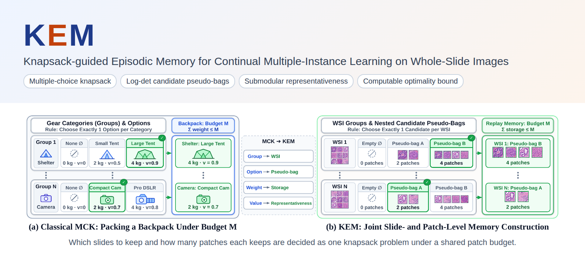
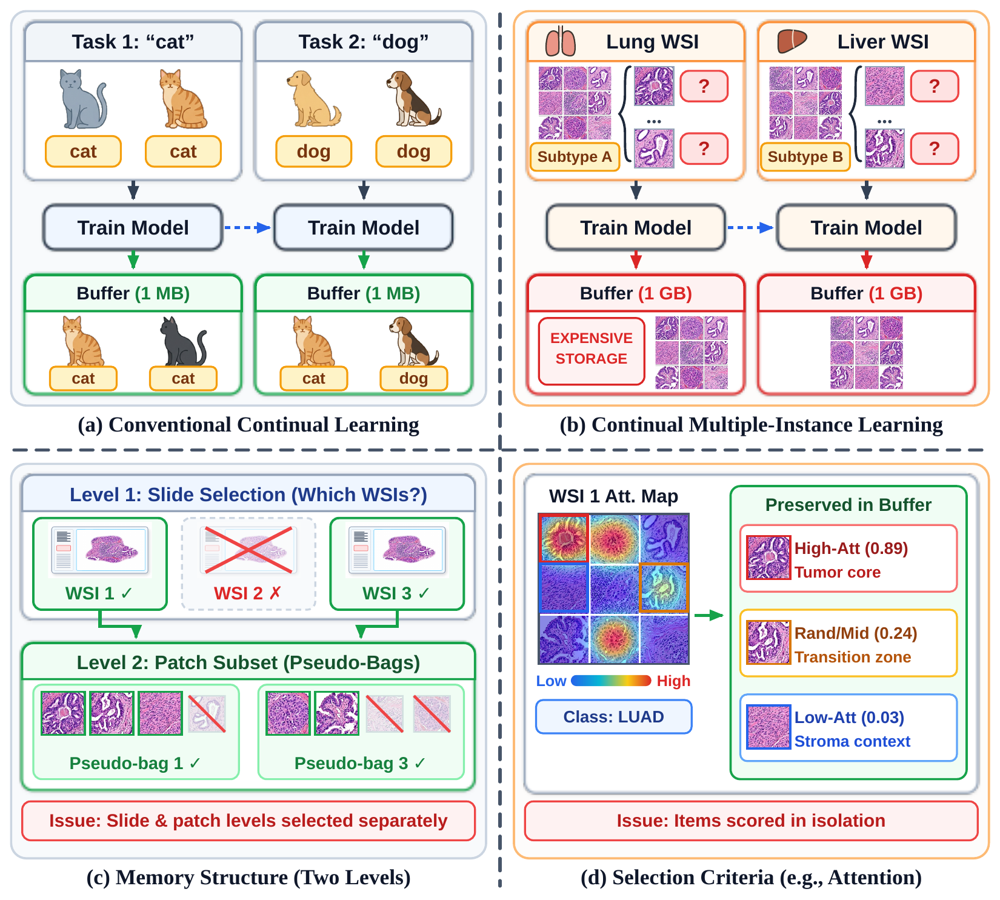
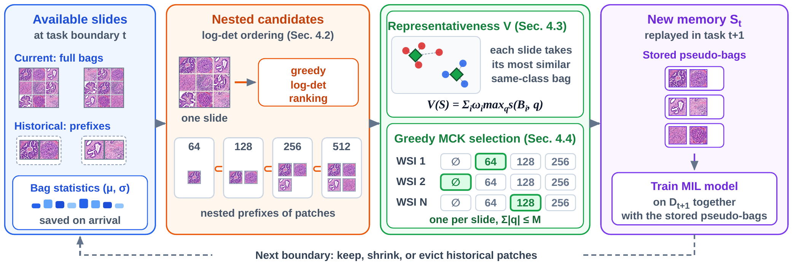
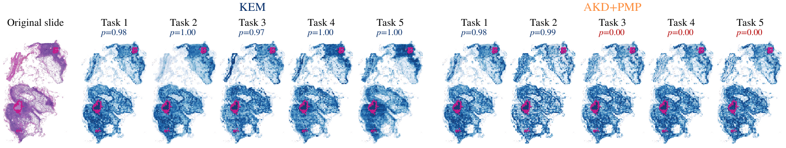
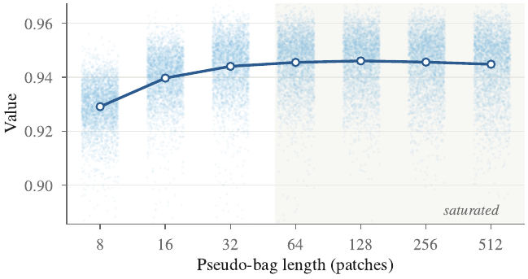
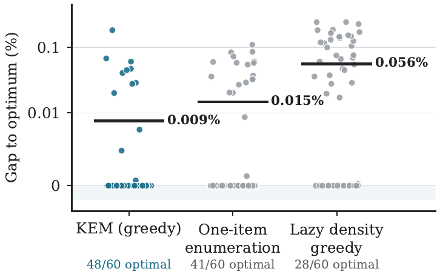

<p align="center">
  
</p>

<div align="center">

**Paper:** coming soon &nbsp;|&nbsp; **Code:** this repository

</div>

## Overview

Continual multiple-instance learning (CMIL) on whole-slide images (WSIs) learns a sequence of diagnostic tasks without
forgetting earlier ones. Replay is the workhorse of continual learning, but a gigapixel WSI is too large to store in full,
so recent methods keep a **hierarchical memory**: they first choose which slides to keep and then which patches of each
slide to store as a *pseudo-bag*. These two decisions are usually made separately.

<p align="center">
  
  <br><em>(a, b) A WSI is far larger than a natural image, so replay cannot store it in full. (c, d) Existing methods choose slides and patches in separate stages and score items in isolation.</em>
</p>

**KEM** casts replay-memory construction as a **multiple-choice knapsack (MCK)** problem:

- **Group** = an available slide; **option** = one of its candidate pseudo-bags (or the empty option); **cost** = the number of stored patches; **budget** = the patch budget *M*.
- **Options:** low-redundancy candidate pseudo-bags are the prefixes (64/128/256/512 patches) of a greedy **log-determinant** ranking of each slide's patches.
- **Value:** a monotone submodular **representativeness** score, i.e. how well every slide is represented by its most similar same-class pseudo-bag, computed from the mean and standard deviation of frozen patch features.
- **Selection:** a greedy MCK solver that admits slides or upgrades their pseudo-bags by value gain per stored patch, with a computable bound on the distance to the optimal memory.

<p align="center">
  
  <br><em>KEM at a task boundary: log-det candidate pseudo-bags for each slide, representativeness value, and greedy MCK selection under the patch budget.</em>
</p>

## Main results

Camelyon–TCGA MorphCL (five tasks, 11 classes, 3,553 WSIs), UNI features, budget *M* = 5,000 patches,
five-fold cross-validation means (standard deviations are in the paper). AACC: final average accuracy (higher is better); FM: forgetting measure (lower is better).

| Method | CLAM-SB AACC ↑ | CLAM-SB FM ↓ | ACMIL AACC ↑ | ACMIL FM ↓ | MambaMIL AACC ↑ | MambaMIL FM ↓ |
|---|---:|---:|---:|---:|---:|---:|
| Fine-tuning | 0.1908 | 0.9566 | 0.1911 | 0.9625 | 0.1868 | 0.9547 |
| Random pseudo-bag | 0.5990 | 0.4486 | 0.6354 | 0.4046 | 0.5078 | 0.5527 |
| ProDiv | 0.5929 | 0.4543 | 0.6500 | 0.3856 | 0.5540 | 0.4980 |
| AKD+PMP | 0.6314 | 0.4046 | 0.6247 | 0.4124 | 0.6394 | 0.3912 |
| **KEM (ours)** | **0.8251** | **0.1654** | **0.7898** | **0.2076** | **0.6501** | **0.3704** |
| Joint training (upper bound) | 0.9167 | – | 0.9061 | – | 0.8918 | – |

AACC of KEM with CLAM-SB across patch budgets:

| Budget (patches) | 2,500 | 5,000 | 10,000 | 15,000 |
|---|---:|---:|---:|---:|
| KEM | 0.7599 | 0.8251 | 0.8698 | 0.8781 |

The full comparison (ER, DER++, PMIL, PseMix, MMIL, ConSlide, COSFormer, AGLR-CL), task-order and encoder robustness,
and all ablations are in the paper.

### Analysis

<p align="center">
  
  <br><em>Attention on a held-out task-1 tumor slide after each task. With KEM the slide stays correctly classified and attention stays on the lesion; with AKD+PMP it is misclassified from task 3 onward.</em>
</p>

<table>
<tr>
<td width="50%" align="center"><br><em>Pseudo-bag value saturates at about 64 patches, so KEM spends the budget on covering more slides.</em></td>
<td width="50%" align="center"><br><em>On 60 instances solved exactly, KEM's greedy selection is within 0.009% of the optimum on average.</em></td>
</tr>
</table>

## Repository structure

```
main_cl.py                 training entry point and continual-learning loop (task sequence, replay, distillation, calibration)
datasets/                  Camelyon--TCGA MorphCL dataset (slide lists, task sequence, feature loading)
models/                    CLAM-SB, ACMIL, MambaMIL
replay/                    memory construction and replay
  kem_v4.py                 candidate pool, region reliability, reliability-weighted log-det candidate ranking
  unified_gradient_coverage.py  bag signatures (mean/std + random projection), representativeness value,
                              greedy MCK allocation, assignment masses
  adaptive_budget_buffer.py, global_budget_buffer.py   global patch budget, eviction/shrinking of stored pseudo-bags
  fixed_replay.py            replay schedule and representation-weighted (W) sampling
  stable_replay.py           classifier calibration after each task
  losses.py                  stored-logit distillation
  conslide_buro.py, full_wsi_buffer.py, pseudobag_*.py, acmil_adapter.py   baselines
configs/presets/           one YAML per (backbone, method), from the final runs
configs/*.json             global patch-budget file
metadata/                  slide list and feature manifest of the benchmark
splits/                    five-fold splits: standard, reversed, and three random task orders
scripts/                   render_preset.py, run_all_folds.sh, summarize_results.py
analysis/optimality_gap/   exact-enumeration check of the greedy allocator
baselines/                 COSFormer and AGLR-CL re-implementations (separate training scripts)
```

Naming in the code: the KEM candidate selector is `kem_v4`, the representativeness objective is
`frozen_feature_coverage`, and the `kem_*` and `unified_*` options are KEM's hyperparameters.

## Installation

Python 3.10, PyTorch 2.9 (CUDA 12.8).

```bash
git clone https://github.com/tAnGjIa520/KEM.git
cd KEM
pip install -r requirements.txt
```

- One GPU with at least 16 GB is enough for CLAM-SB and ACMIL.
- MambaMIL needs `mamba_ssm` and `causal_conv1d` built against the local CUDA toolkit.
- CLAM's instance loss needs the `topk` package (Smooth Top-1 SVM from the smooth-topk project).

## Data and features

Benchmark: Camelyon--TCGA MorphCL, 3,553 slides, five tasks, 11 classes. Slides come from the public Camelyon16 and
TCGA (ESCA, LUAD, LUSC, CRC, STAD, KICH, KIRC, KIRP) collections; `metadata/camelyon_tcga_morph_5t11c_cases.csv`
lists the slides with labels and `metadata/camelyon_tcga_morph_5t11c_manifest.csv` lists, for every slide, the task id,
patch count, relative feature path and a SHA-256 fingerprint of the feature tensor.

Features are 1,024-d UNI patch embeddings of the CLAM patch grid, stored per slide as CLAM-style `.pt` files
(`[n_patches, 1024]` float32) together with `.h5` files holding the patch coordinates. Place them under `FEATURE_ROOT`
with the layout of the `relative_path` column:

```
FEATURE_ROOT/CAMELYON/UNI/pt_files/<slide>.pt        (+ h5_files/<slide>.h5)
FEATURE_ROOT/TCGA/LUAD/UNI/pt_files/<slide>.pt
FEATURE_ROOT/TCGA/{ESCA_ESAD,ESCA_ESCC,LUSC,TCGA_CRC,TCGA_STAD,KICH,KIRC,KIRP}/UNI/pt_files/<slide>.pt
```

The folder names per cohort are listed under `feature_roots` in every preset. Use the fingerprint column to check
that extracted features match the ones used in the paper.

## Quick start: KEM with CLAM-SB (M = 5,000 patches)

```
export FEATURE_ROOT=/path/to/features
export LOG_ROOT=/path/to/output
bash scripts/run_all_folds.sh clam_sb__kem "1 2 3" "0 1 2 3 4"     # 3 seeds x 5 folds
python scripts/summarize_results.py $LOG_ROOT clam_sb__kem
```

`run_all_folds.sh` renders `configs/presets/clam_sb__kem.yaml` for every (seed, fold) and calls
`python main_cl.py --preset <rendered yaml>`. A single run:

```
python scripts/render_preset.py --preset clam_sb__kem --seed 1 --fold 0 \
    --feature-root $FEATURE_ROOT --log-root $LOG_ROOT --run
```

The preset is the argument file of a final run. Main settings: log-det candidate ranking over an attention-stratified pool
of at most 2,048 patches (`kem_v4_selection_rule: logdet`, `kem_v4_candidate_max: 2048`), nested prefixes
64/128/256/512 (`buffer_patch_levels`), frozen-feature signatures (mean and standard deviation, 64-d random projection,
`unified_frozen_signature_mode: mean_std`, `unified_projection_dim: 64`), class-conditioned coverage
(`unified_objective: frozen_feature_coverage`), assignment-mass replay (`unified_assignment_weighted_replay: true`),
stored-logit distillation weight 0.1 (`stored_logits_lambda`), and classifier calibration (`head_calibration: true`).
Per-fold results are written to `$LOG_ROOT/<preset>_fold<f>_seed<s>/fold_<f>_results.csv` (accuracy of every task after every task).

## Other backbones, budgets and baselines

- Backbones: `acmil__kem`, `mambamil__kem` (same arguments as the CLAM-SB preset, with the backbone settings changed).
- Patch budgets: add `--set buffer_patch_budget=2500` (or 10000, 15000) to `render_preset.py`; no other argument changes.
- Baselines (all four backbone prefixes `clam_sb__`, `acmil__`, `mambamil__`; `joint` is the joint-training reference):
  `random`, `attention`, `akd_pmp`, `pmil`, `prodiv`, `psemix`, `mmil`, `full_wsi_er`, `full_wsi_derpp`, `finetune`, `joint`;
  `clam_sb__conslide_buro` (ConSlide with CLAM-SB). `pmil`, `prodiv`, `psemix`, `mmil` are the variants that train on their
  stored pseudo-bags (`replay_pseudobag_train` in the preset).
- Run any of them with `bash scripts/run_all_folds.sh <preset> "1 2 3" "0 1 2 3 4"`.

## Robustness settings (task order and feature encoder)

Presets exist for KEM and the baselines of the robustness table (`finetune`, `full_wsi_er`, `full_wsi_derpp`, `akd_pmp`,
`conslide_buro`) with the prefixes `order_reverse__`, `order_random_1__`, `order_random_2__`, `order_random_3__`,
`encoder_ctranspath__` and `encoder_uni2h__`, e.g. `bash scripts/run_all_folds.sh order_random_1__kem "1" "0 1 2 3 4"`.
The task orders are stored in the split files (`splits/Camelyon_TCGA_morph_5t11c/{reverse,order_random_1..3}`).
The encoder presets use the standard split and read features from `<cohort>/CTransPath` (768-d) or `<cohort>/UNI2-h`
(1,536-d) under `FEATURE_ROOT`, in the same layout as the UNI features; extract them yourself with the CLAM pipeline and the
respective encoder weights (not included).

## Optimality-gap check

`analysis/optimality_gap/` reproduces the 60 small instances (15 fold/subset pairs x 4 budgets; eight slides, four per class,
prefix options 64/128/256) on which KEM's greedy allocator is compared with exact enumeration and two reference greedy solvers.
It needs the task-0 candidate archives of the KEM CLAM-SB run (seed 1, folds 0-4), written during training when
`unified_candidate_cache: true` (preset `clam_sb__kem`; the archives are in `$LOG_ROOT/candidate_cache/<run name>/`; collect the five
`fold<f>_task0_*.pt` files in one directory):

```
python analysis/optimality_gap/run_gap.py --cache-root CACHE_DIR --run-root OUT_DIR
```

Results go to `OUT_DIR/reports/FACILITY_GAP/{per_instance.csv,summary.csv,manifest.json}`. The slide subsets are fixed by
`per_instance.csv`. The files `per_instance.csv`, `summary.csv` and `manifest.json` in the folder are the outputs of the run reported in the paper
(mean relative gap of the production allocator 0.0089%, maximum 0.182%). `benchmark_facility_gap.py` holds the solvers and the
instance construction; `gaps_main_paired.py` and `gaps_pairing.diff` show how `run_gap.py` fixes the slide subsets.

## Large-memory baselines: COSFormer and AGLR-CL

`baselines/cosformer` and `baselines/aglr_cl` hold the re-implementations used in Table 1 (own training scripts, same splits,
metadata and UNI features; not driven by `main_cl.py`). Weights and features that are not part of this package:

- COSFormer: a frozen PubMedBERT snapshot for the decoder word vectors (`prepare_words.py --model <local snapshot> --revision <hash>
  --output <dir>`), the CONCH image/text encoder checkpoint (`conch` package) used for retrieval, and CONCH patch features of the
  benchmark slides (`<cohort>/CONCH/h5_files`, same patch grid as the UNI features; `check_conch.py` verifies coordinates and the
  checkpoint interface). Install `nystrom-attention==0.0.9`.
  Training: `python baselines/cosformer/train_morphcl.py --manifest metadata/camelyon_tcga_morph_5t11c_manifest.csv --features $FEATURE_ROOT
  --splits splits/Camelyon_TCGA_morph_5t11c/standard --words WORDS_DIR --conch-cache CONCH_FEATURE_ROOT --conch-checkpoint CONCH_CKPT
  --output OUT --fold F --seed S --tasks 5 --epochs 50 --replay-updates 3900 --capacity 26 --threads 4 --accept-legacy-conch`
  (one fold and seed per call; the flag acknowledges that the CONCH features are used as provided, without re-verification against a reference extraction).
  Setting: five tasks, 50 epochs per task, 3,900 replay updates per later task, memory of 26 whole slides.
- AGLR-CL: no external weights. `python baselines/aglr_cl/train_morphcl.py --manifest metadata/camelyon_tcga_morph_5t11c_manifest.csv
  --features $FEATURE_ROOT --splits splits/Camelyon_TCGA_morph_5t11c/standard --output OUT --fold F --seed S --fit-backend cuda
  --threads 8 --gmm-max-iter 500`.

## Acknowledgements

This code builds on several open-source projects, including
[CLAM](https://github.com/mahmoodlab/CLAM), ACMIL, MambaMIL, 2DMamba, and smooth-topk,
and re-implements ConSlide, COSFormer, and AGLR-CL from their papers. We thank the authors for releasing their work.
Slides come from the public Camelyon16 and TCGA collections.

## Citation

If you find this work useful, please cite our paper (the BibTeX entry will be added when the paper is public).
